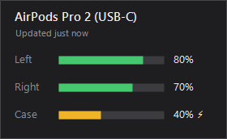

# PodBattery: check AirPods battery on Windows (free AirPods app for Windows 10 & 11)

**PodBattery is a free, open-source AirPods app for Windows that shows your AirPods battery level on your PC or laptop.** See the left earbud, right earbud and charging case battery percentage, and whether each one is charging, right from the Windows system tray. It's a single ~30 KB file: no installer, no account, no iPhone needed.



Windows 10 and Windows 11 don't show AirPods battery levels the way an iPhone or Mac does. PodBattery adds that missing AirPods battery indicator to Windows.

**[⬇ Download PodBattery for Windows](../../releases/latest)**

## Features

- **AirPods battery percentage on Windows:** left, right and case, plus charging status
- **Battery level in the system tray:** the icon shows your lowest earbud's level at a glance, colored green, amber or red
- **Click for details:** a small panel with a battery bar for each earbud and the case
- **Start with Windows:** optional, from the right-click menu
- **Tiny and free:** one ~30 KB exe, no installer, no background services, no ads, no subscription
- **Private:** works completely offline and sends nothing anywhere
- **Open source:** MIT license, build it yourself with one command

## Supported AirPods

| Model | Battery shown |
|---|---|
| AirPods (1st, 2nd and 3rd generation) | Left, right, case |
| AirPods 4 and AirPods 4 (ANC) | Left, right, case |
| AirPods Pro, AirPods Pro 2 (Lightning and USB-C), AirPods Pro 3 | Left, right, case |
| AirPods Max and AirPods Max (USB-C) | Headphone battery |

Other Apple earbuds that send the same Bluetooth messages still show battery levels, under the generic name "AirPods".

## How to check your AirPods battery on Windows

1. Download `PodBattery.exe` from the [latest release](../../releases/latest).
2. Run it. The PodBattery icon appears in the system tray (check the `^` overflow next to the clock).
3. Open your AirPods case near the PC, or take the AirPods out. Your AirPods battery level appears within a few seconds.
4. Hover over the icon for a quick summary, or click it for the full battery panel.

> **"Windows protected your PC" warning:** PodBattery isn't code-signed, so Windows SmartScreen may warn you the first time. Click **More info**, then **Run anyway**. If you'd rather not, build it yourself from the source (below). It only takes one command.

**Requirements:** a Windows 10 or Windows 11 PC or laptop with Bluetooth (Bluetooth Low Energy). The .NET Framework it needs is built into Windows.

## PodBattery vs other AirPods apps for Windows

| | PodBattery | MagicPods | AirPodsDesktop | Bluetooth Battery Monitor |
|---|---|---|---|---|
| Price | **Free** | Paid | Free | Paid (free trial) |
| Open source | **Yes (MIT)** | No | Yes (GPL-3.0) | No |
| Size / install | **~30 KB, no installer** | Microsoft Store app | Full app with installer | Installer |
| Left, right and case battery | Yes | Yes | Yes | Varies by device |
| Extras (in-ear detection, animations, other brands) | No | Yes | Some | Other Bluetooth devices |

PodBattery does one thing: show your AirPods battery on Windows, as lightly as possible. If you want a **free MagicPods alternative** just for battery levels, PodBattery is it. If you want extras like in-ear detection or pop-up animations, MagicPods and AirPodsDesktop offer more.

## How it works

AirPods constantly send out short Bluetooth Low Energy messages so nearby Apple devices can show the battery pop-up. Those messages include the battery level of each earbud and the case. PodBattery listens for them with the Windows Bluetooth API and reads the battery levels. It doesn't connect to your AirPods, pair with them or change anything on them, so it works whether your AirPods are connected to your PC, your phone, or nothing at all.

### Limitations

- **10% steps:** AirPods only share battery levels in 10% steps in these messages, so you'll see 80%, 90% and so on, not 87%. Exact levels are only available over Apple's private protocol, which Windows apps can't use.
- **The case must be open, or the AirPods out:** AirPods don't send these messages while they're closed in the case.
- **Nearest pair wins:** the messages don't say whose AirPods they are, so PodBattery shows the strongest signal nearby. In a room full of AirPods, it may occasionally show someone else's.

## FAQ

**How do I check my AirPods battery on Windows 11?**
Windows 11 has no built-in way to see the left, right and case battery levels of your AirPods. Install a small app like PodBattery: run it, open your AirPods case, and the battery percentage shows up in the system tray.

**How do I check my AirPods battery on Windows 10?**
The same way: PodBattery works on Windows 10 and Windows 11. Run it and open your AirPods case near the PC.

**Does Windows show AirPods battery percentage?**
Not properly. Depending on your setup, Settings → Bluetooth & devices may show at most a single battery level while the AirPods are connected, never the separate earbud and case levels. That's why AirPods battery percentage often seems to be "not showing" on Windows.

**Can I see my AirPods battery on my laptop?**
Yes. PodBattery works on any Windows laptop or desktop PC with Bluetooth.

**Is there a free AirPods app for Windows?**
Yes. PodBattery is free and open source, with no ads, trial or subscription.

**Is there a free alternative to MagicPods?**
For battery levels, yes: PodBattery shows your AirPods battery on Windows for free. See the [comparison](#podbattery-vs-other-airpods-apps-for-windows).

**How do I check AirPods Pro or AirPods Pro 2 battery on Windows?**
PodBattery supports AirPods Pro, AirPods Pro 2 (Lightning and USB-C) and AirPods Pro 3, and shows the model name along with each battery level.

**Can I check AirPods Max battery on Windows?**
Yes. For AirPods Max, PodBattery shows the headphones' single battery level.

**Can I check my AirPods case battery on a PC?**
Yes, as long as at least one AirPod is in the case and the lid is open.

**Can I check AirPods battery without an iPhone?**
Yes. PodBattery reads the battery directly from the AirPods over Bluetooth. You don't need an iPhone, a Mac or an Apple account.

**Do my AirPods need to be connected to the PC?**
No. PodBattery reads the battery from the messages AirPods send out, so it works even if they're connected to your phone.

**Why doesn't it show the exact percentage?**
AirPods only share 10% steps in their public Bluetooth messages. See [Limitations](#limitations).

**Is it safe?**
PodBattery is open source, so you can read every line. It has no network access, collects nothing, and only changes your system if you turn on "Start with Windows".

## Build from source

No SDK or Visual Studio needed. PodBattery builds with the C# compiler that ships with Windows:

```bat
build.cmd
```

That produces `PodBattery.exe` next to the source.

## Credits

- The AirPods message layout and the "strongest recent signal" approach follow the reverse-engineering published by [OpenPods](https://github.com/adolfintel/OpenPods) (Android).
- Model IDs were cross-checked against [AirPodsDesktop](https://github.com/SpriteOvO/AirPodsDesktop).

## License

[MIT](LICENSE)

*PodBattery is an independent project and is not affiliated with, endorsed by or sponsored by Apple Inc. AirPods, AirPods Pro and AirPods Max are trademarks of Apple Inc. MagicPods and other product names are trademarks of their respective owners.*
